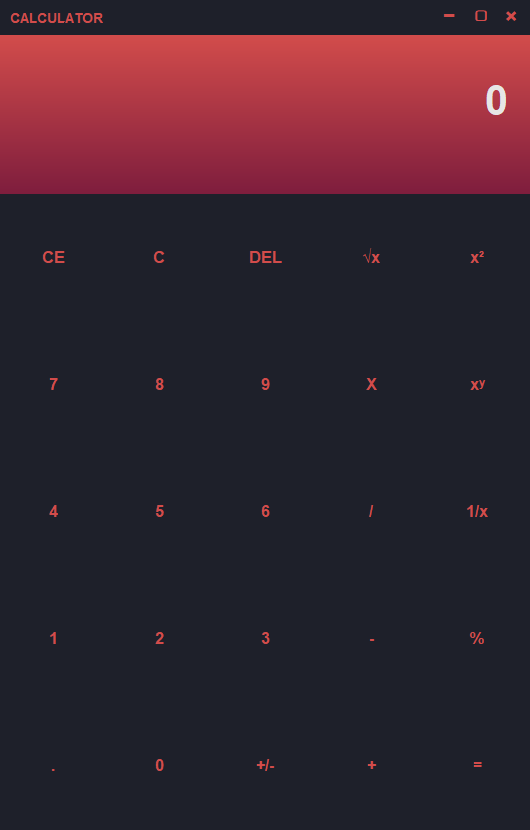

# Calculator

A desktop calculator written in Java with Swing. It evaluates whole expressions with normal operator precedence, shows a running result while you type, and can be used from the on-screen keypad or the keyboard. The project runs in both NetBeans and VS Code.

<p align="center">
  
</p>

## Features

- Chained expressions with proper precedence, so `1 + 2 * 3` gives `7`
- A live preview of the result underneath the expression
- Operators `+`, `-`, `*`, `/` and `^` (power)
- Square root, square, reciprocal, percent and sign toggle
- Percent works the way phone calculators do: `200 + 10%` becomes `200 + 20`
- Full keyboard input
- Readable error messages for things like division by zero or overflow
- A dark, frameless window with its own draggable title bar and minimize, maximize and close buttons

## Requirements

- JDK 11 or newer. It was developed with JDK 26 in NetBeans, but the code only uses Java 8 features, so any recent JDK will build it.
- No external libraries are needed to run the app. The jars in `lib/` (JUnit 4 and Hamcrest) are only used by the tests.

## Getting started

```
git clone https://github.com/warmnights/java-swing-calculator.git
cd java-swing-calculator
```

Then run it in the editor you prefer.

### NetBeans

Open the project folder (File > Open Project) and press Run. The main class is `calculator.CalculatorFrame`.

### VS Code

Install the Extension Pack for Java, open the folder, then open `CalculatorFrame.java` and use the Run button above `main`. The included `.vscode/settings.json` already points VS Code at the `src`, `test` and `lib` folders, so no extra setup is needed.

### Command line

From the project root:

```
javac -d out src/calculator/*.java
java -cp out calculator.CalculatorFrame
```

## Keyboard shortcuts

| Key | Action |
| --- | --- |
| `0`-`9`, `.` | Enter a number |
| `+` `-` `*` `/` `^` | Choose an operator |
| `%` | Percent |
| `=` or `Enter` | Calculate |
| `Backspace` | Delete the last character |
| `Delete` | Clear the current number (CE) |
| `Esc` | Clear everything (C) |

Square root, square, reciprocal and sign toggle are available from the keypad.

## Project layout

```
.vscode/
    settings.json           shared VS Code settings (source folders and libraries)
lib/
    junit-4.13.2.jar        test library
    hamcrest-core-1.3.jar   required by JUnit 4
nbproject/                  NetBeans project files
src/calculator/
    CalculatorEngine.java   expression state and all of the math, no Swing
    CalculatorFrame.java    the window, keypad and keyboard handling
    GradientPanel.java      the gradient behind the display
test/calculator/
    CalculatorEngineTest.java
build.xml                   Ant build file used by NetBeans
manifest.mf
```

The engine and the window are deliberately separate. `CalculatorEngine` only deals with text and numbers, so it can be tested without opening a window. `CalculatorFrame` forwards every button press or key press to the engine and then redraws the display from whatever the engine reports.

`CalculatorFrame.initComponents()` and the event handler stubs are generated by the NetBeans form editor. If you edit the layout, do it in the editor rather than by hand.

## Tests

The engine has JUnit 4 tests covering precedence, input handling, editing, percent, error cases and number formatting. JUnit 4 is used because NetBeans runs tests in Ant projects through Ant's `<junit>` task, which does not support JUnit 5.

- **VS Code:** open the Testing view (beaker icon) and run the tests, or click **Run Test** above a test in `CalculatorEngineTest.java`. The jars in `lib/` are picked up automatically.
- **NetBeans:** run Test Project (Alt+F6). If NetBeans reports that JUnit is missing, right-click Test Libraries, choose Add Library, and pick JUnit 4.13.x.

## Known limitations

- Results are rounded to 10 decimal places.
- Operators of the same rank are evaluated left to right, including `^`, so `2 ^ 3 ^ 2` is `64`, not `512`.
- There is no memory or history.